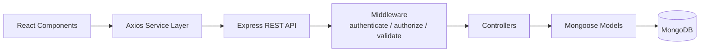
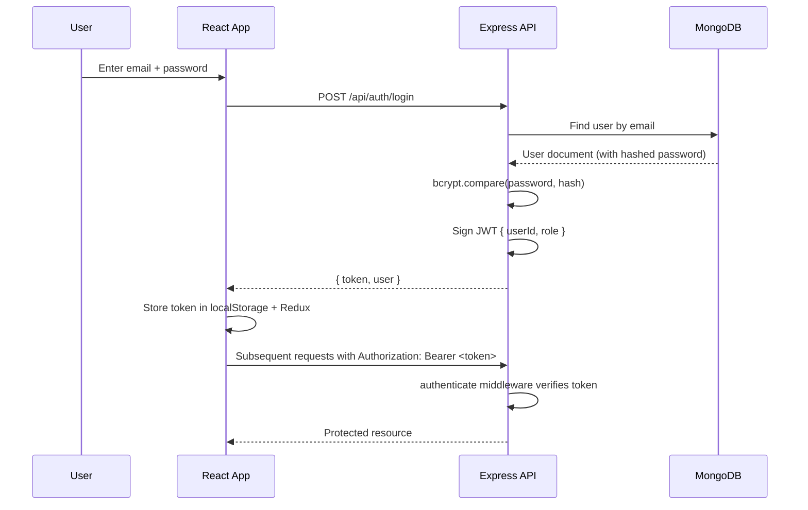

# Architecture

TaskFlow follows a straightforward layered architecture with no microservices, message queues, or caching layers — just a React SPA talking to a single Express REST API backed by MongoDB.

## Request Flow



1. **React Components** render pages and call functions from the `services/` layer — they never call `axios` or `fetch` directly.
2. **Axios Service Layer** (`client/src/services/*.ts`) wraps every API endpoint in a typed function and attaches the JWT via a request interceptor.
3. **Express REST API** receives the request and routes it to the matching router.
4. **Middleware** runs first: `authenticate` verifies the JWT and loads the user, `authorize(...roles)` checks the user's role, and `validate(schema)` checks the request body with Zod.
5. **Controllers** contain the actual business logic (e.g. "only return tasks assigned to this user if they're a USER").
6. **Mongoose Models** define schemas, validation, and hooks (e.g. hashing a password before save).
7. **MongoDB** persists the data.

## Authentication Flow



## Role-Based Authorization

Every protected route is wrapped with two middleware functions:

```text
authenticate            → verifies the JWT and attaches req.user
authorize("ADMIN", ...) → checks req.user.role is in the allowed list
```

Authorization is enforced **only on the backend**. The frontend also hides buttons/routes a role shouldn't see, but this is a UX convenience — the API independently rejects any unauthorized request with `403 Forbidden`, even if the request bypasses the UI entirely (verified in [testing.md](./testing.md)).

## Why This Architecture

This structure was chosen deliberately over more "enterprise" patterns (repository pattern, CQRS, dependency injection containers) because:

- It maps directly to how Express and Mongoose are taught and documented, making it easy to explain in a viva.
- Every layer has exactly one responsibility, so a reviewer can trace a request from click to database in under a minute.
- There is no infrastructure to run beyond Node.js and MongoDB — no Docker, no Redis, no queues.
